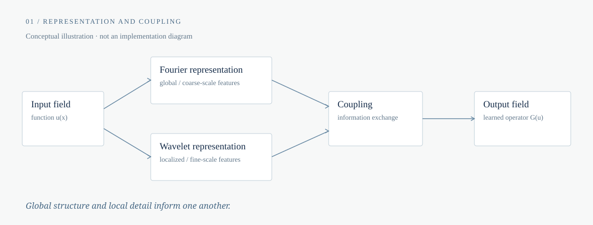
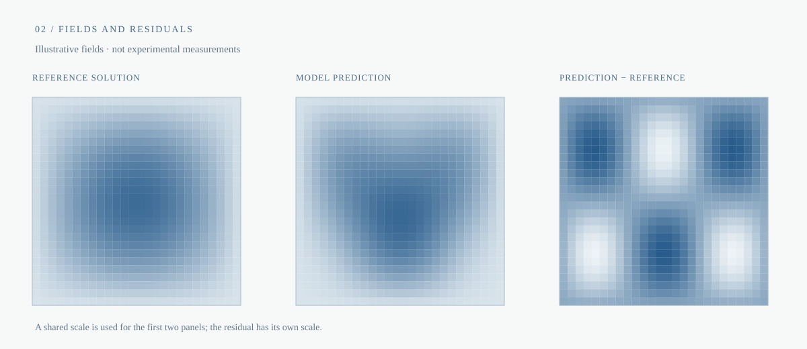

<picture>
  <source media="(prefers-color-scheme: dark)" srcset="assets/hero-dark.svg">
  <source media="(prefers-color-scheme: light)" srcset="assets/hero-light.svg">
  
</picture>

## About

I am a student at Letovo School interested in how mathematics and computation can help us understand physical systems. My focus is on scientific machine learning: in particular, learning operators between function spaces and studying how their behavior changes across scales and spatial discretizations.

I work with Python and Java, and I am drawn to questions where a useful model must be understood as well as computed.

 

## Research projects

### 01 — WFNO / Coupled

**Fourier–wavelet neural operators · ongoing research**

This project explores how Fourier-based and wavelet-based representations might interact within a neural operator. Fourier representations provide a way to describe global structure, while wavelets offer localized representations at multiple scales. The question is how information exchange between coarse-scale features and fine details might support the learning of operators on functions.

The directions of inquiry include accuracy, numerical stability under varying conditions, and generalization across spatial discretizations, including cross-resolution transfer. These are research questions, not claims of established results.

Figure 01. Conceptual illustration; it is neither an exact implementation diagram nor an experimental result.

 

### 02 — PDE Lab

**Partial differential equations · visualization and model comparison**

PDE Lab is a research-oriented application for visualizing solutions to partial differential equations and comparing prediction errors across computational models. It is designed around a practical question: what can the structure of a numerical prediction—and of its error—tell us about a model's behavior?

Figure 02. Schematic fields, not measurements. The first two panels share a color scale; the signed residual uses a separate scale.

 

## Open science mission

> I want the work I contribute to make its reasoning visible enough for others to test, question, and carry forward.

Science is cumulative: a result becomes a foundation when others can understand the assumptions and methods beneath it. Openness, to me, is therefore more than releasing code. It is a way to invite independent examination and make scientific reproducibility possible. That aspiration has practical limits and requires care; it is not a claim that every project is already open or reproducible.

Mathematics gives an investigation structure; computation lets us explore its consequences. When the reasoning and tools can be inspected and reused, a question can grow beyond the person who first asked it. I hope to contribute to that shared process, where criticism and extension are part of discovery.

 

## Research interests

**Learning operators**  ·  Neural operators  /  Scientific machine learning  /  Numerical generalization

**Understanding physical systems**  ·  Physics  /  Partial differential equations  /  Numerical stability

**Working across scales**  ·  Multiscale methods  /  Fourier and wavelet representations  /  Cross-resolution transfer

 

*Mathematics frames the question; computation explores it; shared inquiry deepens understanding.*
