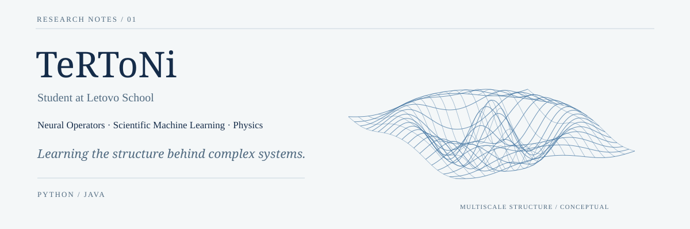
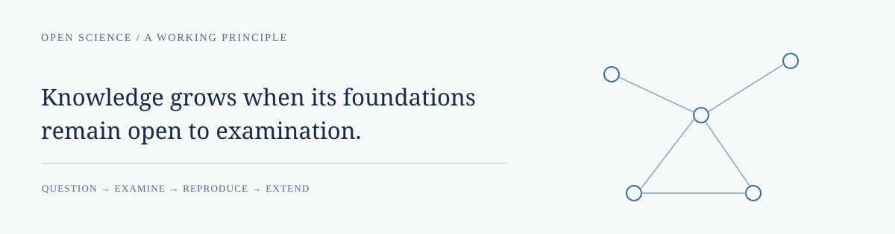

<picture>
  <source media="(prefers-color-scheme: dark)" srcset="assets/hero-dark.svg">
  <source media="(prefers-color-scheme: light)" srcset="assets/hero-light.svg">
  
</picture>

## About

I am a student at Letovo School interested in mathematics, physics, and scientific machine learning. I am especially curious about neural operators and how they learn relationships between functions across different scales and spatial discretizations.

I work with Python and Java. My favorite book is *Fluid Mechanics*, Volume 6 of Landau and Lifshitz’s *Course of Theoretical Physics*.

 

## Open science mission

> “If I have seen further, it is by standing on the shoulders of giants.”
>
> — Isaac Newton

I hope to add, however modestly, to this growing ocean of knowledge: to learn from those who came before me, share what I find, and leave something for others to carry further.

 

## Research interests

**Methods**  ·  Neural operators  /  Scientific machine learning  /  Multiscale methods

**Mathematics and physics**  ·  Partial differential equations  /  Fourier and wavelet representations

**Questions**  ·  Numerical stability  /  Generalization  /  Cross-resolution transfer

 

## Research projects

**01 — WFNO / Coupled** · Ongoing research on combining Fourier and wavelet representations in neural operators, with a focus on accuracy, stability, and generalization across spatial discretizations.

**02 — PDE Lab** · An application for visualizing solutions to partial differential equations and comparing model predictions and errors.
